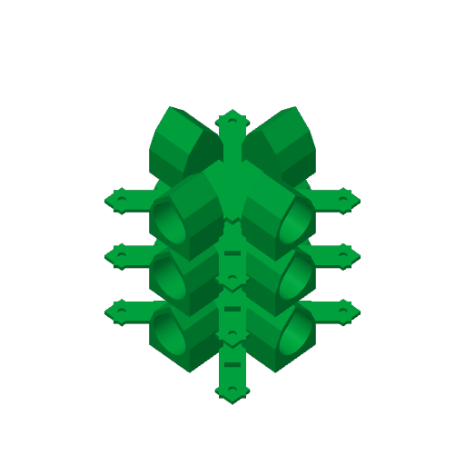

# Three-cross vertical batch / A1 Mini PETG

[Open the editable, unsliced Bambu Studio project](THREE_CROSSES_STACK_A1Mini_PETG.3mf). The original production CROSS shape is unchanged. Three disconnected solids are intentionally held in one object to preserve their Z positions. **Do not split to objects, auto-arrange or drop the upper solids to the bed.**

Each cross is 53.3449 mm tall. The three bottoms are at **0, 57.4 and 114.8 mm**, with **4.0551 mm clear gaps**. Total model height is **168.1449 mm**, within the A1 Mini's 180 mm height. Four parts would require 213.3797 mm even without gaps. Footprint is 136.6274 mm square, centered on the bed, with about 21.69 mm margin before supports/brim.

The editable project inherits the A1 Mini / 0.4 mm nozzle / Generic PETG / 0.20 mm layer / four-wall / 20% infill settings. Starting support settings are **Normal (auto)**, **On build plate only OFF**, 0.2 mm top and bottom support Z distances, plus a 5 mm outer brim. **Print by layer**, not by object. Adjust the support settings and click Slice Plate in Bambu Studio. Supports must reach the flat undersides of both elevated crosses; the gaps are not intended to bridge unsupported.

A local validation slice preserved all three heights and generated support and interface toolpaths, with no final plate warning. That starting slice estimates **628.54 g PETG / 24 h 03 min**, including supports and brim. Three individual production prints total about **397.77 g / 15 h 13 min**, so stacking saves plate changes but substantially increases material and printing time with these support settings. The validation result is in [slice_checks.json](slice_checks.json); the editable file is deliberately unsliced so you can generate your own supports. The optional [validation slice](slice_check/THREE_CROSSES_STACK_SLICE_CHECK.3mf) is available for comparison.

This is an **unproven stacking trial**, not a validated unattended production job. Upper parts print on PETG supports instead of the build plate. Check the generated layers for continuous support under the elevated pieces and access for removing supports from socket mouths and magnet pads. The 0.4 mm magnet-pocket skins can be damaged during support removal; lower fitting tops may also show support marks. Do not assume the single-part fit test establishes the stack's surface quality or reliability. No print has been sent to the machine.

The gate needs four crosses: this batch supplies three; use the existing single-cross project for the fourth. No new cross variant is required.

Build the editable project with `python3 scripts/build_cross_stack.py`. It copies the native single-cross geometry and preset configuration, strips its old G-code and previews, and applies translations only. [Layout checks](layout_checks.json) verify exact copied vertices and the bed envelope.
