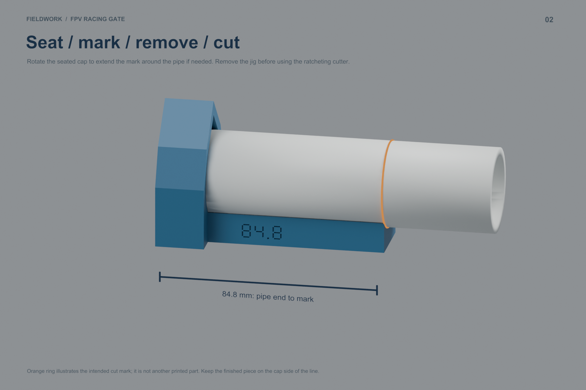
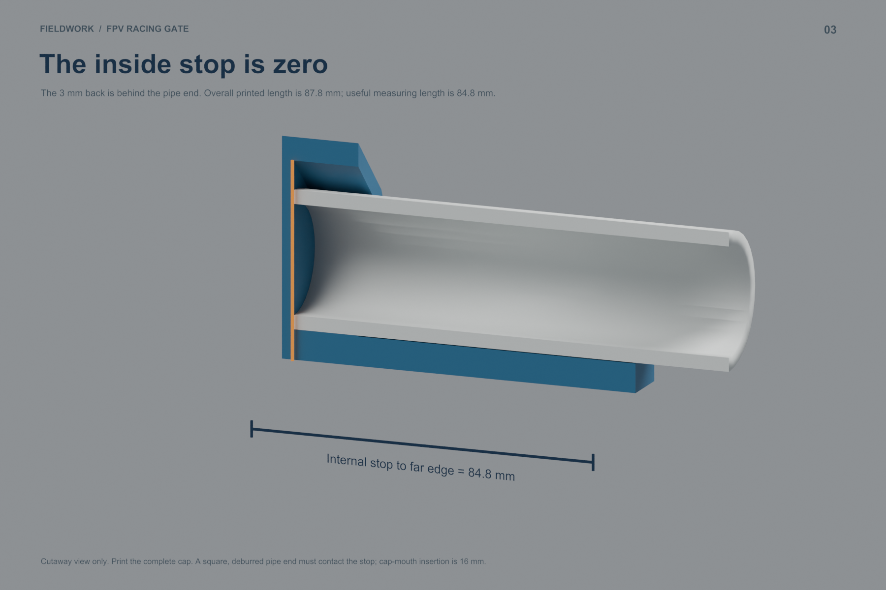

# 84.8 mm PVC end-cap measuring jig

A **single printed cap with a rigid measuring tab** for the 84.8 mm PVC pieces used by both 12-inch-paper compact gates. Slide it onto a squared pipe end until the end contacts the cap's internal stop. The far end of the tab is **84.8 mm from that stop**.

**Print:** [A1 Mini PETG sliced project](sliced/ONE_END_CAP_GAUGE_84_8/ONE_END_CAP_GAUGE_84_8_A1Mini_PETG.3mf) · [STL](printable/END_CAP_GAUGE_84_8.stl) · [geometry-only 3MF](printable/ONE_END_CAP_GAUGE_84_8.3mf) · [Blender model](Short_Pipe_Gauge.blend)

- One part, **24.98 g PETG / approximately 85 minutes** according to Bambu Studio; about $0.25 in filament at the owner's price.
- **87.8 × 41.5 × 53.345 mm** print bounds; fits the 180 mm A1 Mini bed with ample margin.
- **33.5 mm bore**, using the same horizontal peaked bore and 16 mm engagement as the accepted sleeve. The new closed-back tool still needs its own physical seating check.
- 3 mm closed back; internal pipe-end stop at X=0; marking edge at X=84.8 mm. Overall part length is **87.8 mm**, not the measuring length.
- 24 mm wide curved tab, at least 7.05 mm thick. Nominal radial clearance from a 33.4 mm pipe is 0.25 mm along the tab. The tab supports marking without gripping the full pipe length.
- Recessed **84.8** identification on the side. No hardware, magnets, separate joints or supports.

## Print settings

Use the supplied orientation: flat cap foot and tab on the bed, pipe axis parallel to the bed. A1 Mini, 0.4 mm nozzle, Generic PETG, 0.20 mm layers, four walls, 20% infill, textured PEI, supports off. Print at **100% scale**. The supplied 3MF is sliced and checked; no job has been sent to the printer.

## Use it

1. Square and deburr the starting pipe end. Debris or an angled end can prevent consistent contact with the internal stop.
2. Slide the cap onto that end and press gently until it seats against the stop. The cap mouth is 16 mm from the stop.
3. Use a fine pencil or marker at the **far end of the tab**. That end face is the 84.8 mm datum. Keep the point close to the pipe and the line narrow; a thick marker line adds uncertainty.
4. If you need a longer line, rotate the cap around the pipe while keeping it seated against the end. Recheck seating as you rotate; do not tilt the tool to reach the pipe.
5. **Remove the jig before cutting** with the HUSKY ratcheting cutter. It is a measuring/marking tool, not a cutter guide or blade stop. Keep the finished piece on the cap side of the line and account for the blade's position.
6. Measure the first finished piece before making the other fifteen. Aim for 84.8 mm within about ±0.5 mm and consistent repeats; verify that short corner in the printed fittings. Repeat from the freshly cut, checked end of the remaining stock.

## Verify the first print

CAD and exported STL checks confirm a nominal **84.8 mm internal-stop-to-tip distance**, but that is not a guarantee of physical print accuracy. Check the overall length against 87.8 mm as an initial screen, and then check an actual marked/cut pipe with calipers or a reliable ruler. A first-layer lip, shrinkage, stop seating and marker width can affect the result. Do not sand the stop or marking face as a routine cleanup step, because that changes the measuring length. Remove only burrs or unwanted print artifacts.

If a repeatable length error remains, adjust the tab length in CAD and reprint while preserving the accepted bore. Avoid uniformly scaling the part: it would also change the PVC fit. The 30 mm assembly insertion for gate fittings is already included in the 84.8 mm cut length; this measuring cap has its own shorter 16 mm engagement.

[Isolated printable part](renders/01_PRINTABLE_GAUGE.png) · [Validation report](print_checks.json) · [Compact-gate cut guide](../compact_gate_study/PVC_Cut_Guide.md)

Checks: one connected manifold CAD solid; exported STL stop location and dimensions; positive solid volume; one model on the A1 Mini plate with at least 5 mm margin; PETG settings; supports disabled, no support toolpaths and no slicer warnings. Strength, fit and measuring accuracy still require the first physical print.

Rebuild from the repository root: `blender -b -t 8 --python scripts/build_short_pipe_gauge.py`, `python3 scripts/slice_short_pipe_gauge.py`, then `python3 scripts/validate_short_pipe_gauge.py`. Uses the existing production PETG preset files.
